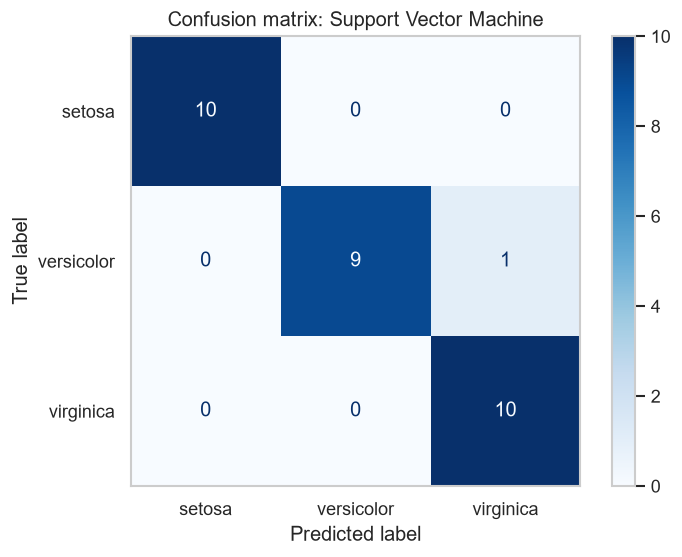
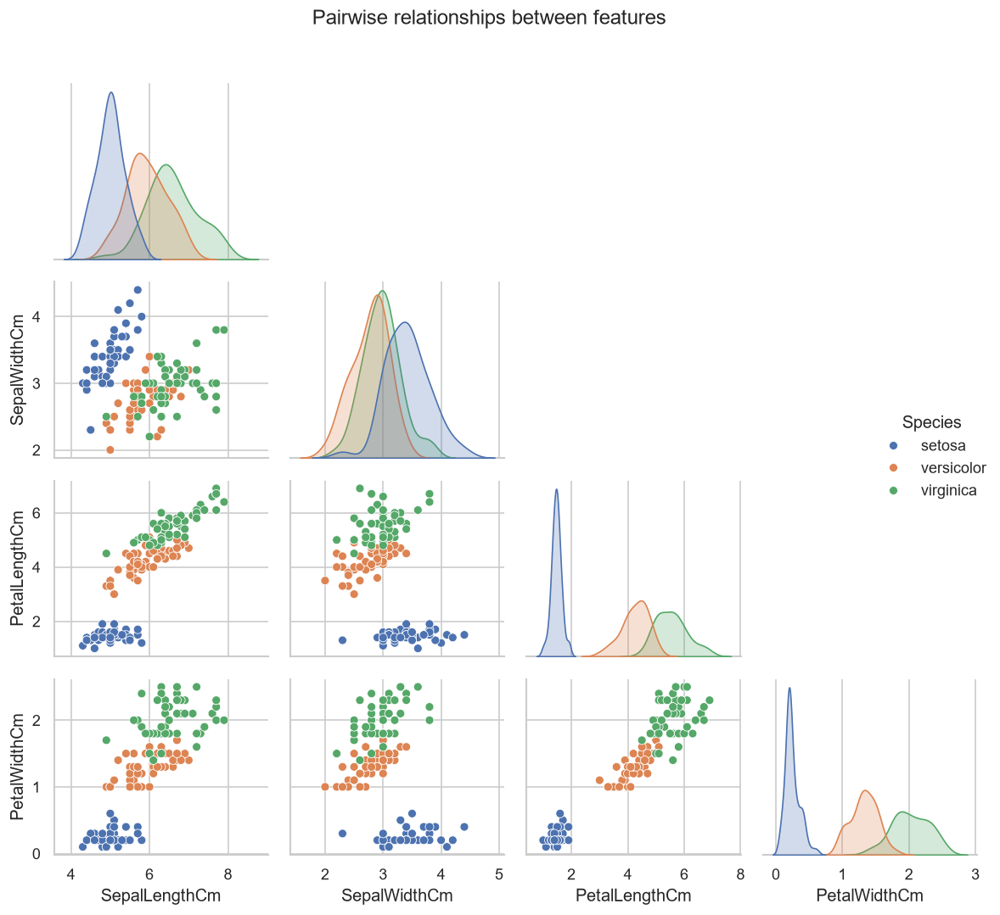
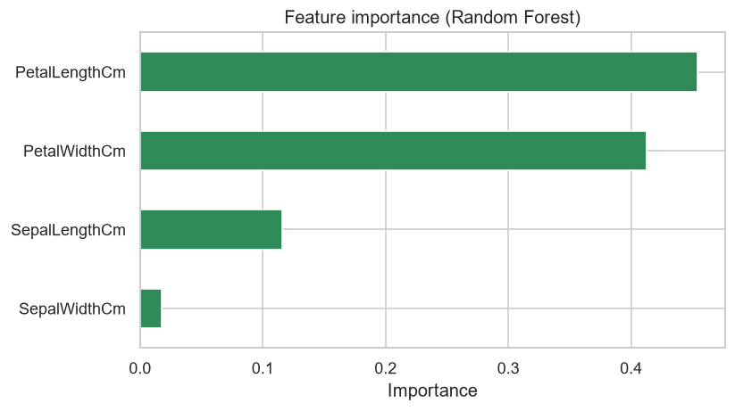

# CodeAlpha: Iris Flower Classification

**Data Science Internship, Task 1 (CodeAlpha)**

A machine learning model that classifies iris flowers into three species (*setosa*, *versicolor* and *virginica*) using four measurements: sepal length, sepal width, petal length and petal width.

## Results

| Model | 5-fold CV Accuracy | Test Accuracy |
|---|---|---|
| **Support Vector Machine (best)** | **96.7%** | **96.7%** |
| Logistic Regression | 95.8% | 93.3% |
| K-Nearest Neighbors | 95.8% | 93.3% |
| Decision Tree | 95.0% | 90.0% |
| Random Forest | 95.0% | 90.0% |

The best model classifies **29 of the 30** unseen test flowers correctly. The only mistake is one *versicolor* predicted as *virginica*; these two species overlap slightly in their measurements.



## Key findings
- **Petal length and petal width** are the most important features (about 87% of Random Forest importance combined).
- *Setosa* is completely separable from the other two species.
- The dataset is clean and balanced (50 flowers per species, no missing values).




## Project structure
```
CodeAlpha_IrisFlowerClassification/
├── data/Iris.csv                  # Dataset (from Kaggle)
├── images/                        # Charts generated by the code
├── model/iris_model.joblib        # Saved trained model
├── iris_classification.ipynb      # Notebook with code, outputs and explanations
├── iris_classification.py         # Same analysis as a plain Python script
└── requirements.txt
```

## Workflow
1. **Load and clean:** drop the `Id` column, check for missing values and duplicates, and simplify the species names
2. **EDA:** summary statistics, pairplot, box plots and a correlation heatmap
3. **Split:** 80% train and 20% test, stratified by species
4. **Model:** five classifiers, each in a `StandardScaler` pipeline, compared with 5-fold cross-validation
5. **Evaluate:** accuracy, precision, recall, F1-score and the confusion matrix on the test set
6. **Predict:** save the model and classify new flower measurements

## How to run
```bash
pip install -r requirements.txt
python iris_classification.py      # or: jupyter notebook iris_classification.ipynb
```

## Using the saved model
```python
import joblib
import pandas as pd

bundle = joblib.load("model/iris_model.joblib")
flower = pd.DataFrame([[6.0, 2.9, 4.5, 1.5]], columns=bundle["features"])
print(bundle["encoder"].inverse_transform(bundle["model"].predict(flower)))  # ['versicolor']
```

## Dataset
[Iris dataset on Kaggle](https://www.kaggle.com/datasets/saurabh00007/iriscsv): 150 samples, 4 features and 3 classes.

## Tech stack
Python · Pandas · NumPy · Scikit-learn · Matplotlib · Seaborn · Jupyter
